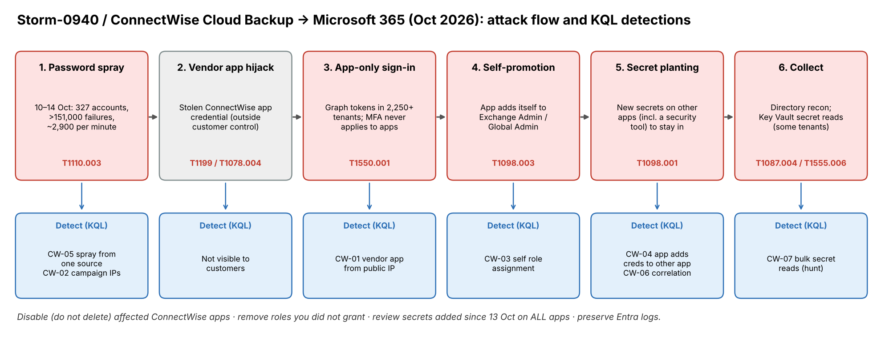

# Storm-0940 / ConnectWise Cloud Backup → Microsoft 365 (October 2026): KQL Detections for Microsoft Sentinel

> Portfolio project: detection engineering for the October 2026 supply-chain attack in which a stolen ConnectWise Cloud Backup (formerly SkyKick) application credential was used to sign in to customers' Microsoft 365 tenants. Seven KQL queries for Microsoft Sentinel / Defender, a response playbook and a MITRE ATT&CK mapping.
>
> **Framework version:** MITRE ATT&CK Enterprise v20.1 · **Query language:** KQL (syntax-validated with Microsoft's Kusto parser) · **Analysis date:** 21 November 2026

## 1. Executive summary

In mid-October 2026 an attacker took control of several ConnectWise multi-tenant cloud application identities, starting with ConnectWise Cloud Backup. Because customers had already consented to these apps, the attacker could sign in to their Microsoft 365 tenants **as the vendor's app**: no user signed in, so MFA never applied.
Huntress confirmed unauthorised app sign-ins in 162 tenants by 16 October; Microsoft reported attempts against more than 2,250 tenants at up to 2,900 sign-in attempts per minute. In some tenants the apps assigned themselves Exchange Administrator or Global Administrator and planted new secrets on other applications to keep access.
On 21 October Microsoft attributed the campaign to **Storm-0940**, a China-state-aligned actor that used the agentic AI framework **ARTEX** to run it at machine speed. ConnectWise disabled seven application identities, revoked their credentials and began a phased restoration.
**Key lesson:** application identities are privileged accounts that MFA does not protect. They need the same monitoring as admins: baselines for where they sign in from, and alerts when they change roles or credentials, theirs or anyone else's.

## 2. Timeline

| Date (2026) | Event | Source |
| --- | --- | --- |
| From early September | Storm-0940 uses ARTEX against hundreds of organisations | Microsoft |
| 10–14 October | Password spray from 144.172.64.99: 327 accounts at eight organisations, >151,000 failures, peak ~2,900 per minute on 11 Oct; no successful logons in that run | Microsoft via Huntress |
| 14 October | ConnectWise later says it discovered unauthorised access to Cloud Backup application identities on this date | ConnectWise via eeNews Europe |
| 15 October | Cloud Backup identity signs in to customer tenants from 144.172.64.128 and gets Microsoft Graph tokens; from ~01:58 UTC, Cloud Management apps assign themselves directory roles in ~50 Huntress-monitored tenants | Huntress |
| 16 October | ConnectWise advisory (IOC 144.172.64.128); Huntress confirms unauthorised sign-ins in 162 tenants | ConnectWise, Huntress |
| 17 October | ConnectWise disables seven application identities (07:00 UTC) and revokes credentials; issued tokens may stay valid until expiry | ConnectWise |
| 18 October | ConnectWise adds IOCs 144.172.64.99 and 144.172.64.60 | ConnectWise |
| 21 October | Microsoft attributes the campaign to Storm-0940 using ARTEX; ConnectWise begins phased restoration | Microsoft, ConnectWise |
| 28 October | Microsoft 365 backup and restore available again for re-authorised tenants | Shattered.io |
| 13 November | FBI FLASH on ARTEX cites the campaign (attempts against 2,250+ tenants) | FBI |

## 3. How the attack worked

1. **Machine-speed reconnaissance and spraying.** ARTEX automated scanning and password spraying across many organisations at once.
2. **Vendor app takeover.** The attacker obtained a credential for the ConnectWise Cloud Backup app. Huntress notes the credential type was a client assertion that "lives in the vendor's own tenant": nothing a customer did could have prevented it. How it was stolen has not been published.
3. **App-only sign-in to customers.** The app signed in from a hosting-provider IP and received Microsoft Graph tokens, inheriting every permission customers had granted (mail, files, directory). Legitimate traffic from the app came from Azure private IP space.
4. **Privilege escalation.** Related ConnectWise Cloud Management apps added themselves to directory roles, mostly Exchange Administrator, and Global Administrator in at least one tenant.
5. **Persistence by "secret planting".** With admin rights, an app added new credentials to other applications in the tenant, including a security vendor's app. Disabling the ConnectWise apps does **not** remove these.
6. **Collection.** Microsoft reports Graph and directory reconnaissance, and Defender for Cloud detected bulk secret reads from Azure Key Vaults via a compromised multi-tenant app. Huntress saw no mail or file access in the tenant it reviewed in detail, but Graph directory reads leave little audit trail.

## 4. MITRE ATT&CK mapping

| # | Phase | Technique | Status | Detection |
| --- | --- | --- | --- | --- |
| 0 | AI tooling | T1588.007 Artificial Intelligence · T1588.002 Tool | Observed (Microsoft) | – |
| 1 | Password spray | T1110.003 Password Spraying | Observed | CW-05, CW-02 |
| 2 | Vendor app as entry | T1199 Trusted Relationship | Observed | CW-01 |
| 2 | Stolen app credential | T1078.004 Valid Accounts: Cloud Accounts | Observed | CW-01, CW-02 |
| 3 | App-only Graph tokens | T1550.001 Application Access Token | Observed | CW-01 |
| 4 | Directory recon | T1087.004 Account Discovery: Cloud Account | Observed (Microsoft) | Limited logging |
| 5 | Self-assigned roles | T1098.003 Additional Cloud Roles | Observed | CW-03, CW-06 |
| 6 | Secret planting | T1098.001 Additional Cloud Credentials | Observed | CW-04, CW-06 |
| 7 | Key Vault secrets | T1555.006 Cloud Secrets Management Stores | Reported (some tenants) | CW-07 (hunt) |
| 8 | Mail access / forwarding | T1114.002 Remote Email Collection · T1114.003 Email Forwarding Rule | Hunt (not confirmed) | Review mailbox audit |

_Navigator layer: [`layers/attack-layer.json`](layers/attack-layer.json)_

## 5. KQL detections

All queries are in [`detections/kql/`](detections/kql/) and were **syntax-validated with Microsoft's Kusto language parser** (`@kusto/language-service-next`). They have not been run against live tenant data; adjust table names and thresholds to your environment.

| ID | Query | Table | Catches | Confidence |
| --- | --- | --- | --- | --- |
| CW-01 | [Vendor app sign-in from a public IP](detections/kql/CW01_vendor_app_signin_unexpected_ip.kql) | `AADServicePrincipalSignInLogs` | Any of the seven ConnectWise app IDs signing in successfully from a non-private IP | High for this campaign |
| CW-02 | [Known campaign IPs](detections/kql/CW02_known_campaign_ips.kql) | `SigninLogs`, `AADServicePrincipalSignInLogs` | User or app sign-ins from the published 144.172.64.x / 144.172.94.243 addresses since 1 Oct | High, but ages quickly |
| CW-03 | [Service principal adds itself to a role](detections/kql/CW03_service_principal_self_role_assignment.kql) | `AuditLogs` | An app granting **itself** a directory role; "High" for Global/Exchange/Application Administrator | **High** (generic, survives IOC changes) |
| CW-04 | [App adds credentials to another app](detections/kql/CW04_app_adds_credentials_to_other_app.kql) | `AuditLogs` | Secrets or certificates added to an application by a **different** application | Medium alone (some automation does this legitimately) |
| CW-05 | [Password spray from one source](detections/kql/CW05_password_spray_single_source.kql) | `SigninLogs` | Many accounts failing from one IP, with peak failures per minute | Medium (tune thresholds) |
| CW-06 | [Escalation + persistence correlation](detections/kql/CW06_escalation_plus_persistence_correlation.kql) | `AuditLogs` | The same app self-assigns a role and then plants credentials on other apps within 2 hours | **High** |
| CW-07 | [Bulk Key Vault secret reads (hunt)](detections/kql/CW07_hunt_keyvault_bulk_secret_reads.kql) | `AzureDiagnostics` | An app reading many secrets or several vaults within an hour | Hunting |

**Making it generic:** CW-01 is written for the ConnectWise app IDs. For other vendors, baseline each multi-tenant app's usual source IPs over 30 days and alert on new ones. CW-03, CW-04 and CW-06 do not depend on this campaign at all and catch the same playbook from any compromised app.

## 6. Response playbook (if you used ConnectWise Cloud Backup or SkyKick)

| Step | Action | Why |
| --- | --- | --- |
| 1. Preserve | Export Entra sign-in and audit logs, Purview Audit and SIEM data from at least **1 October** before changing anything | Entra keeps logs for a limited time; evidence is needed later |
| 2. Contain | **Disable, do not delete**, the affected enterprise applications by app ID | Deleting removes consent and forces re-consent; disabling pauses backups but keeps them |
| 3. Remove roles | Remove any directory role held by ConnectWise/SkyKick service principals that you did not grant | Undo the self-assigned escalation (CW-03) |
| 4. Hunt planted secrets | Review client secrets and certificates on **all** app registrations and enterprise apps added since **13 October**; remove the ones you did not create | Disabling the vendor apps does not remove planted credentials (CW-04) |
| 5. Check other changes | Review consent grants, app owners, group and role changes, Conditional Access exclusions, mail forwarding and inbox rules | Persistence can hide outside the obvious places |
| 6. Rotate | Rotate secrets the apps could read (Key Vault, mailbox-stored credentials) | Data access cannot be ruled out from logs alone |
| 7. Restore | Re-enable only after ConnectWise confirms all credentials are reset, then re-authorise | Tokens issued before revocation could stay valid until expiry |
| 8. Harden | Least privilege for vendor apps; Conditional Access for workload identities (where licensed); alert on CW-03/CW-04/CW-06 permanently | Prevent the next vendor compromise from becoming yours |

## 7. Indicators

| Type | Indicator | Context | Source |
| --- | --- | --- | --- |
| IPv4 | `144.172.64.128` | Vendor-app sign-ins (AS14956, RouterHosting) | Huntress, ConnectWise (16 Oct) |
| IPv4 | `144.172.64.99` | Password spray 10–14 Oct | Huntress, Microsoft, ConnectWise (18 Oct) |
| IPv4 | `144.172.64.60` | A few failed user logons | Huntress, ConnectWise (18 Oct) |
| IPv4 | `144.172.94.243` | Additional password-spraying lead | Huntress via Mitiga |
| App ID | `506e08f9-6e9a-4da4-942b-a099a03644ae` | ConnectWise Cloud Backup | Mitiga |
| App IDs | `2399d300-…`, `24205314-…`, `b78f6a77-…`, `0de14c77-…`, `412dcf96-…`, `b2b55f5b-…` | Cloud Management, Teams, Exchange Online, Graph, Partner Center and SharePoint integrations (full IDs in CW-01) | Mitiga |

Microsoft and Huntress associated different activity with some of these addresses. Verify app IDs against the official ConnectWise advisory before acting.

## 8. Open questions & limitations

- **How was the vendor credential stolen?** Neither ConnectWise nor Microsoft has published the initial compromise of ConnectWise itself. The diagram shows the password spray first because it came first in time, but a causal link to the app takeover is **not** established (the spray had no successful logons).
- **Counts differ.** Huntress: 162 confirmed tenants (its own customers), ~1,000 tenants with sign-in activity from the attacker IP, 300+ successful; Microsoft: attempts against 2,250+ tenants; some media cite 173. They measure different things. Microsoft has not said how many customers were compromised.
- **Data access is unproven either way.** A successful sign-in does not prove data theft, and missing logs do not prove there was none: Graph directory reads leave little audit trail.
- **ARTEX is not a fingerprint.** Microsoft notes many actors use ARTEX, so its presence alone does not indicate Storm-0940.
- **The queries are untested on live data.** They pass the official Kusto syntax parser, but column availability (e.g. `ClientCredentialType`, Key Vault columns) depends on licensing and diagnostic-settings mode.

## 9. Sources

- [Huntress: ConnectWise (SkyKick) vendor credentials abused in M365 attacks](https://www.huntress.com/blog/vendor-credential-enables-unauthorized-access)
- [Huntress Threat Library: Storm-0940](https://www.huntress.com/threat-library/threat-actors/storm-0940)
- [Mitiga: Hunting third-party app abuse in Entra](https://www.mitiga.io/blog/connectwise-breach-entra-app-abuse)
- [BleepingComputer: Hackers breach Microsoft 365 tenants via ConnectWise supply-chain attack](https://www.bleepingcomputer.com/news/security/hackers-breach-microsoft-365-tenants-via-connectwise-supply-chain-attack/)
- [SecurityWeek: ConnectWise suspends cloud services in response to cyberattack](https://www.securityweek.com/connectwise-suspends-cloud-services-in-response-to-cyberattack/)
- [Dark Reading: Microsoft links Storm-0940 to ConnectWise supply chain attack](https://darkreading.com/cyberattacks-data-breaches/microsoft-storm-0940-connectwise-supply-chain-attack)
- [CSO Online: China-linked hackers used agentic AI in attack on 2,250 Microsoft 365 tenants](https://csoonline.com/article/4239028/china-linked-hackers-used-agentic-ai-in-attack-on-2250-microsoft-365-tenants.html)
- [BleepingComputer: FBI warns ARTEX AI hacking tool is powering global cyberattacks](https://www.bleepingcomputer.com/news/security/fbi-warns-artex-ai-hacking-tool-is-powering-global-cyberattacks/)
- [Microsoft Learn: AADServicePrincipalSignInLogs](https://learn.microsoft.com/azure/azure-monitor/reference/tables/aadserviceprincipalsigninlogs) · [AuditLogs](https://learn.microsoft.com/azure/azure-monitor/reference/tables/auditlogs) · [MITRE ATT&CK](https://attack.mitre.org)

## License & attribution

© 2026 Stelios Partsinevelos. Released under the MIT License (see [LICENSE](LICENSE)).

MITRE ATT&CK® is a registered trademark of The MITRE Corporation; ATT&CK content © The MITRE Corporation. Microsoft, Entra, Sentinel and Microsoft 365 are trademarks of Microsoft. This project is not affiliated with or endorsed by Microsoft, ConnectWise, Huntress, MITRE or any vendor named. Queries are provided as-is for defensive use; test before production.
